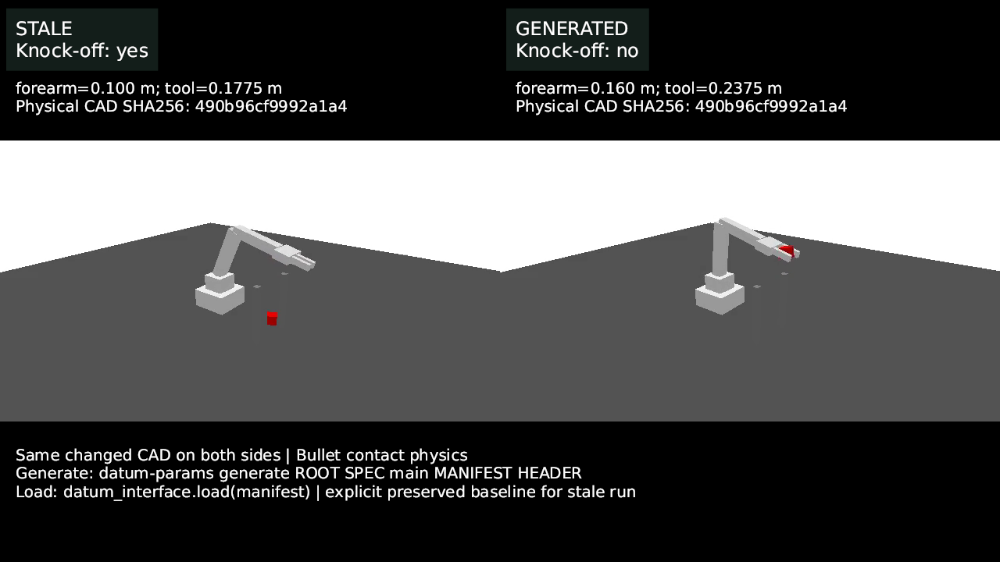
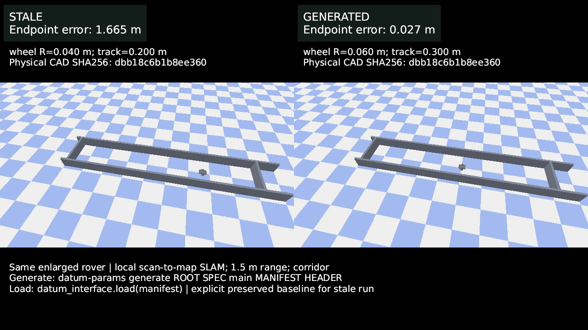
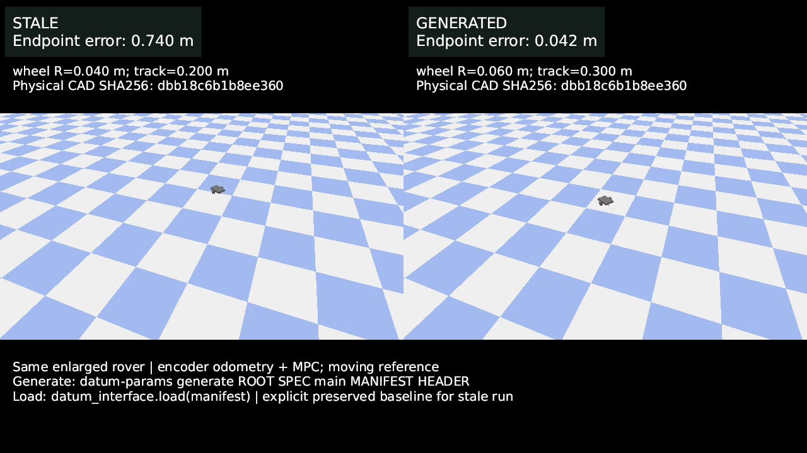
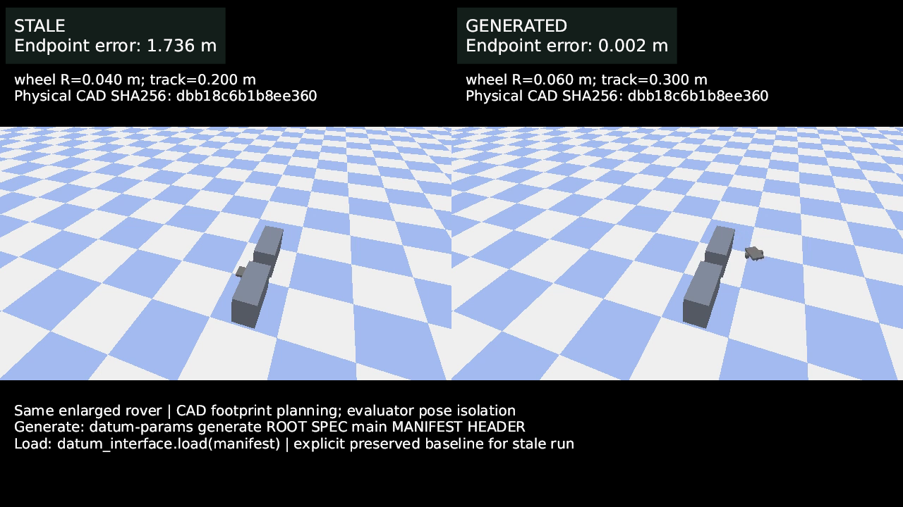

# Datum Parameters

Datum Parameters (DParams) connects explicit dimensions in saved SolidCraft CAD
to the code that uses them. Choose dimensions in the optional local Studio or
write a spec directly, then use the generated Python manifest, C++ header, or
startup evaluation API. DParams works without a Datum version-control project,
account, or cloud service.

## See the demos

Each comparison uses the same changed robot design on both sides. The **stale**
side deliberately uses baseline controller inputs; the **generated** side uses
parameters from the changed design. Select a preview to watch the video.

[](docs/media/dparams-comparisons/arm.mp4)

| Scenario | Comparison video |
|---|---|
| Pick and place | [Watch the arm grasp and place](docs/media/dparams-comparisons/arm.mp4) |
| Rover localization | [](docs/media/dparams-comparisons/slam.mp4) |
| Rover LQR control | [](docs/media/dparams-comparisons/lqr.mp4) |
| Rover MPC control | [](docs/media/dparams-comparisons/mpc.mp4) |
| Rover planning | [](docs/media/dparams-comparisons/planning.mp4) |

These are scripted PyBullet simulations. The arm uses contact physics; the rover
uses a simplified primitive model. The localization example is local
scan-to-map navigation without global loop closure. LQR and MPC combine encoder
odometry and controller-geometry drift, and the planning case uses ground-truth
localization to isolate footprint selection. The recordings illustrate these
scenarios, rather than hardware validation or a guarantee for other robots.
The full simulation sources and evidence are not yet included in this repository.
The videos use earlier API names; use the current commands below for new code.

## Quick install

For the Python package and generator, install Python 3.10+, Rust and Cargo, then:

```sh
git clone https://github.com/jerrying123/datum.git
cd datum
python3 -m venv .venv
. .venv/bin/activate
python -m pip install ./datum_interface
cargo build --locked --manifest-path rust/Cargo.toml --bin datum-params
```

The Python runtime can read a spec and saved CAD without Rust after installation.
The Rust binary is needed to generate a JSON manifest or C++ header. PyPI and
precompiled native release bundles are planned but are not yet published. The
Python distribution is named `datum-parameters`; once published, install it
with `pip install datum-parameters`. The Python import remains `datum_interface`.
The [Releases page](https://github.com/jerrying123/datum/releases) will list
native bundles when available.

## First use: Python without Studio

1. Save your SolidCraft files in a project folder. Inspect a source file's
   `document.json` and choose an explicit numeric dimension. The
   [agent usage guide](docs/AGENT_USAGE.md) includes a complete spec example.
2. Write `PROJECT/datum/spec.json` with the source path, JSON pointer, units and
   a stable parameter name.
3. Read the current saved CAD at startup:

```python
from datum_interface import load_runtime

params = load_runtime("PROJECT", worktree="main")
print(params["forearm_length_m"])  # metres, if mapped in the spec
```

The worktree here is a key in the spec. Runtime values are a startup snapshot;
reload after changing CAD or the spec. Literal numeric dimensions and supported
named literal parameters can be mapped; arbitrary CAD expressions are not
computed by DParams.

## Generate artifacts for Python or C++

Use the same spec and saved CAD to generate a manifest and header:

```sh
rust/target/debug/datum-params generate \
  PROJECT PROJECT/datum/spec.json main \
  PROJECT/datum/parameters.json PROJECT/datum/parameters.hpp
```

Python can load the manifest with
`load_generated("PROJECT/datum/parameters.json", worktree="main")`; it checks
that the spec and recorded CAD hashes still match. C++ can include the generated
header and use its `datum::robot::main` constants. The header contains baked-in
values and does not perform runtime hash checks: regenerate and rebuild when
inputs change. C++ can also evaluate saved CAD at startup through the C ABI;
see the [C++ example](examples/cpp-pick-place/README.md).

## Use the Studio (optional)

Install Docker with Compose and `solidcraft-cli` on the host for visual rendering
and URDF export. From the activated source checkout:

```sh
python -m pip install ./parameter_studio
dparam-std up --source-repo "$PWD" --project /path/to/your/cad/project
```

Open <http://localhost:8000>. Add `--tailscale` to use the printed private
Tailscale URL from another device on your tailnet. In Studio, select a part and
an explicit feature or sketch dimension, add a named code parameter, then
review and generate or download the spec and artifacts. Studio is optional:
constants, derived values, bounds, groups and extra sources can also be authored
directly in the spec. See the [Studio guide](parameter_studio/README.md).

## Examples and reference

- [Standalone C++ pick-and-place](examples/cpp-pick-place/README.md): generated
  header and runtime evaluation against a kinematic arm.
- [ROS 2 Jazzy C++ pick-and-place](examples/ros2_cpp_pick_place/README.md): an
  `rclcpp` controller and action-based kinematic motor simulator.
- [Agent package usage](docs/AGENT_USAGE.md) and the
  [detailed integration guide](datum_interface/python/datum_interface/AGENT_GUIDE.md):
  spec customization, error handling and C++/Python options. The detailed guide
  is also available after installation with
  `python -c "from datum_interface import agent_guide; print(agent_guide())"`.
- [Benchmarks](BENCHMARKS.md): measured startup costs and their limits.
- [Contributor instructions](AGENTS.md): changing this repository.

Studio also supports experimental assembly-to-URDF export. Its structural
checks do not certify CAD fidelity, mass properties or physics readiness; see
the [Studio guide](parameter_studio/README.md#experimental-assembly-to-urdf).

Licensed under Apache-2.0. SolidCraft is a separate dependency and is not
included.
