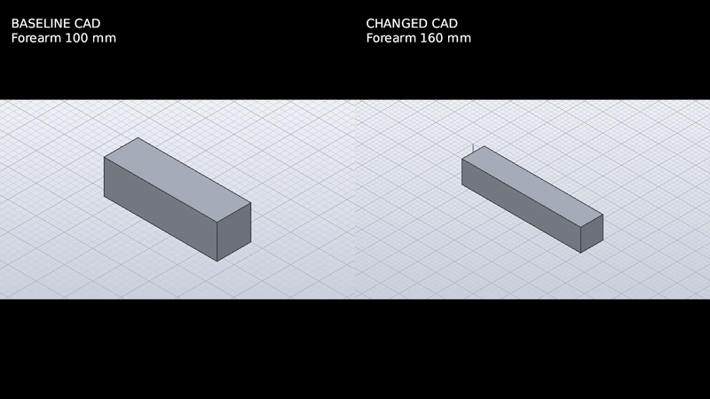
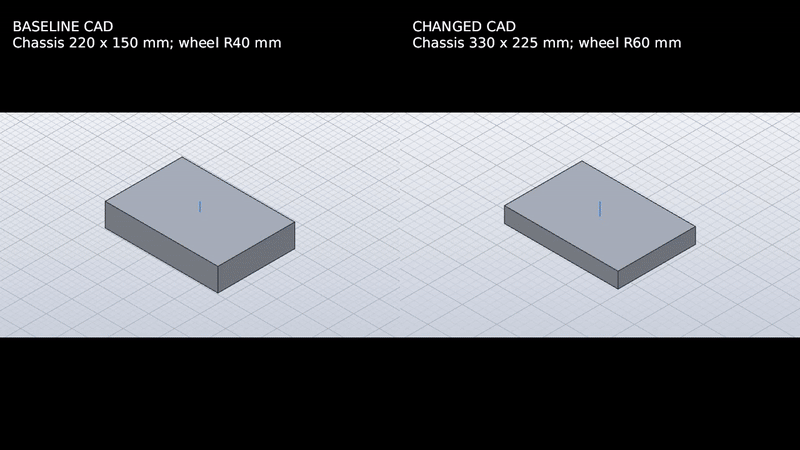
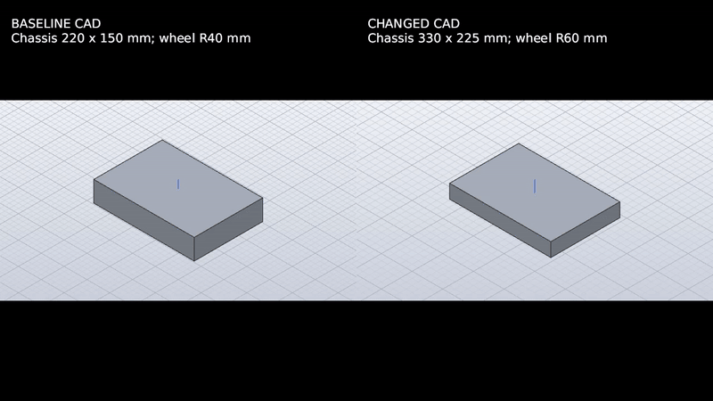
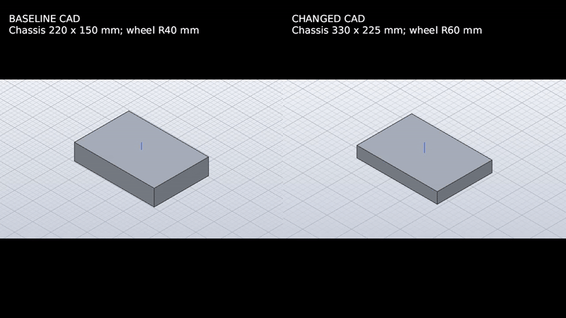
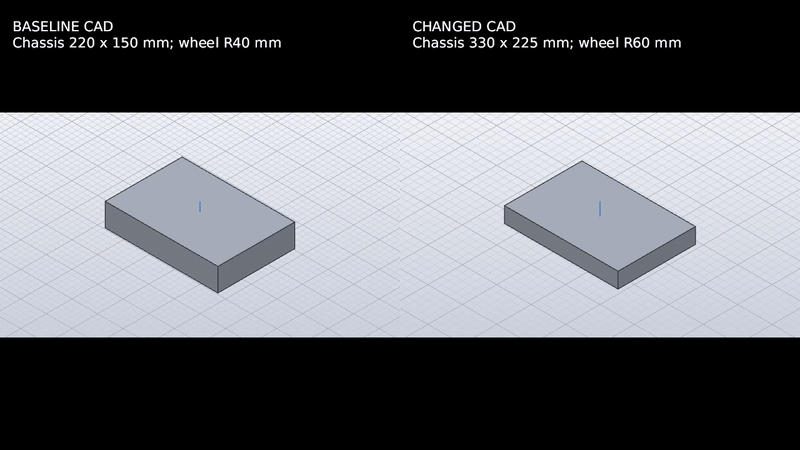

# Datum Parameters

Datum Parameters (DParams) connects explicit dimensions in saved SolidCraft CAD
to the code that uses them. Choose dimensions in the optional local Studio or
write a spec directly, then use the generated Python manifest, C++ header, or
startup evaluation API. DParams works without a Datum version-control project,
account, or cloud service.

## See the demos

Each comparison uses the same changed robot design on both sides. The **stale**
side deliberately uses baseline controller inputs; the **generated** side uses
parameters from the changed design. The comparisons animate inline in the README.



| Scenario | Comparison animation |
|---|---|
| Pick and place |  |
| Rover localization |  |
| Rover LQR control |  |
| Rover MPC control |  |
| Rover planning |  |

These are scripted PyBullet simulations. The arm uses contact physics; the rover
uses a simplified primitive model. The localization example is local
scan-to-map navigation without global loop closure. LQR and MPC combine encoder
odometry and controller-geometry drift, and the planning case uses ground-truth
localization to isolate footprint selection. The recordings illustrate these
scenarios, rather than hardware validation or a guarantee for other robots.
The full simulation sources and evidence are not yet included in this repository.
The videos use earlier API names; use the current commands below for new code.

## Quick install

For the Python package and generator, install Python 3.10+, Rust and Cargo, then:

```sh
git clone https://github.com/jerrying123/datum.git
cd datum
python3 -m venv .venv
. .venv/bin/activate
python -m pip install ./datum_interface
cargo build --locked --manifest-path rust/Cargo.toml --bin datum-params
```

The Python runtime can read a spec and saved CAD without Rust after installation.
The Rust binary is needed to generate a JSON manifest or C++ header. PyPI and
precompiled native release bundles are planned but are not yet published. The
Python distribution is named `datum-parameters`; once published, install it
with `pip install datum-parameters`. The Python import remains `datum_interface`.
The [Releases page](https://github.com/jerrying123/datum/releases) will list
native bundles when available.

## First use: Python without Studio

1. Save your SolidCraft files in a project folder. Inspect a source file's
   `document.json` and choose an explicit numeric dimension. The
   [agent usage guide](docs/AGENT_USAGE.md) includes a complete spec example.
2. Write `PROJECT/datum/spec.json` with the source path, JSON pointer, units and
   a stable parameter name.
3. Read the current saved CAD at startup:

```python
from datum_interface import load_runtime

params = load_runtime("PROJECT", worktree="main")
print(params["forearm_length_m"])  # metres, if mapped in the spec
```

The worktree here is a key in the spec. Runtime values are a startup snapshot;
reload after changing CAD or the spec. Literal numeric dimensions and supported
named literal parameters can be mapped; arbitrary CAD expressions are not
computed by DParams.

## Try a CAD change on the next simulation run

The standalone [C++ example](examples/cpp-pick-place/README.md) builds a
kinematic pick-and-place simulator and a runtime controller. From the repository
root, with the quick-install environment active, a C++17 compiler, `sha256sum`,
and SolidCraft's `solidcraft-cli` on `PATH`, run the following. The destination
must not exist; it is a disposable project created by the script.

```sh
examples/cpp-pick-place/run.sh /tmp/dparams-walkthrough
/tmp/dparams-walkthrough/pick_place_runtime /tmp/dparams-walkthrough/baseline /tmp/dparams-walkthrough/baseline pass /tmp/dparams-walkthrough/before.json
python -c "from datum_interface import load_runtime; print(load_runtime('/tmp/dparams-walkthrough/baseline')['forearm_length_m'], 'm')"
```

The baseline forearm is 100 mm, so the printed controller input is `0.1 m`.
Now change and save the disposable CAD: this command creates a new native box
with a 160 mm length at the same mapped feature and saves it over the example's
forearm. In your own project, edit and save the mapped dimension in SolidCraft
instead. Do not overwrite your own CAD with this command.

```sh
cat > /tmp/dparams-walkthrough/edited-forearm.json <<'JSON'
{"commands":[{"command":"solid.box","params":{"length":160,"width":30,"height":30,"body_name":"forearm"}}]}
JSON
rm /tmp/dparams-walkthrough/baseline/cad/forearm.solidcraft
solidcraft-cli run /tmp/dparams-walkthrough/edited-forearm.json --save /tmp/dparams-walkthrough/baseline/cad/forearm.solidcraft --quiet
/tmp/dparams-walkthrough/pick_place_runtime /tmp/dparams-walkthrough/baseline /tmp/dparams-walkthrough/baseline pass /tmp/dparams-walkthrough/after.json
python -c "from datum_interface import load_runtime; print(load_runtime('/tmp/dparams-walkthrough/baseline')['forearm_length_m'], 'm')"
```

The next run reads `0.16 m`; the runtime evidence files record the values and
source hashes actually consumed. Both project arguments above point to the same
saved CAD: the first supplies controller dimensions and the second supplies the
simulated arm dimensions. The simulation reports its grasp, lift and place
stages. It is a kinematic model, not a CAD geometry or contact simulation;
changing a controller parameter alone does not update a simulator's geometry.
The stale/current comparison printed by `run.sh` uses two separately created
projects and is not itself an edit-and-rerun demonstration.

Runtime loading takes a fresh snapshot at process startup; restart after saving.
For generated artifacts, regenerate after the save: checked Python manifests
reject changed sources, and C++ headers require regeneration **and a rebuild**.
For a ROS 2 generated-header consumer, see the
[ROS 2 example](examples/ros2_cpp_pick_place/README.md): regenerate its header
and rebuild the node before restarting it. For actual exported CAD geometry, see
the separate [PyBullet example](examples/pybullet_sim/README.md).

## Generate artifacts for Python or C++

Use the same spec and saved CAD to generate a manifest and header:

```sh
rust/target/debug/datum-params generate \
  PROJECT PROJECT/datum/spec.json main \
  PROJECT/datum/parameters.json PROJECT/datum/parameters.hpp
```

Python can load the manifest with
`load_generated("PROJECT/datum/parameters.json", worktree="main")`; it checks
that the spec and recorded CAD hashes still match. C++ can include the generated
header and use its `datum::robot::main` constants. The header contains baked-in
values and does not perform runtime hash checks: regenerate and rebuild when
inputs change. C++ can also evaluate saved CAD at startup through the C ABI;
see the [C++ example](examples/cpp-pick-place/README.md).

## Use the Studio (optional)

Install Docker with Compose and `solidcraft-cli` on the host for visual rendering
and URDF export. From the activated source checkout:

```sh
python -m pip install ./parameter_studio
dparam-std up --source-repo "$PWD" --project /path/to/your/cad/project
```

Open <http://localhost:8000>. Add `--tailscale` to use the printed private
Tailscale URL from another device on your tailnet. In Studio, select a part and
an explicit feature or sketch dimension, add a named code parameter, then
review and generate or download the spec and artifacts. Studio is optional:
constants, derived values, bounds, groups and extra sources can also be authored
directly in the spec. See the [Studio guide](parameter_studio/README.md).

## Examples and reference

- [Standalone C++ pick-and-place](examples/cpp-pick-place/README.md): generated
  header and runtime evaluation against a kinematic arm.
- [PyBullet simulation](examples/pybullet_sim/README.md): run a simple arm or
  export the included SolidCraft assembly at startup.
- [MuJoCo 4 simulation](examples/mujoco_sim/README.md): load and step the same
  exported assembly with MuJoCo.
- [ROS 2 Jazzy C++ pick-and-place](examples/ros2_cpp_pick_place/README.md): an
  `rclcpp` controller and action-based kinematic motor simulator.
- [Agent package usage](docs/AGENT_USAGE.md) and the
  [detailed integration guide](datum_interface/python/datum_interface/AGENT_GUIDE.md):
  spec customization, error handling and C++/Python options. The detailed guide
  is also available after installation with
  `python -c "from datum_interface import agent_guide; print(agent_guide())"`.
- [Benchmarks](BENCHMARKS.md): measured startup costs and their limits.
- [Immediate roadmap](docs/ROADMAP.md): prioritized CAD, simulation workspace and ROS 2 work.
- [Contributor instructions](AGENTS.md): changing this repository.

Studio also supports experimental assembly-to-URDF export. Its structural
checks do not certify CAD fidelity, mass properties or physics readiness; see
the [Studio guide](parameter_studio/README.md#experimental-assembly-to-urdf).

Licensed under Apache-2.0. SolidCraft is a separate dependency and is not
included.

Studio frontend contributors: see the [frontend build and distribution commands](parameter_studio/README.md#frontend-development-and-distribution).
Build the TypeScript browser bundle before packaging Studio; pip installation does
not install npm dependencies. Docker rebuilds the bundle from its authored source.

Studio supports [CAD feature states](parameter_studio/README.md#cad-feature-states) for simulation and URDF export.
