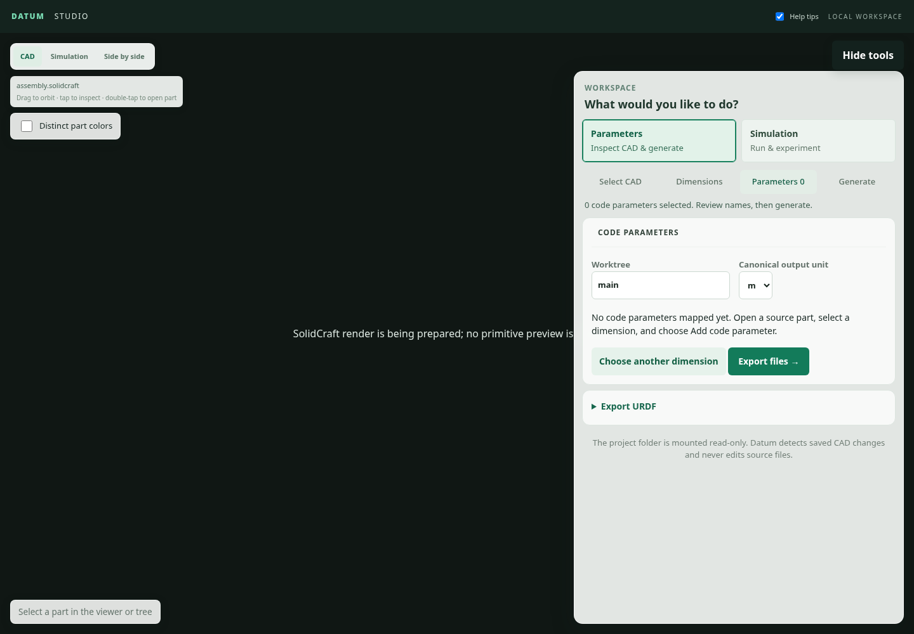
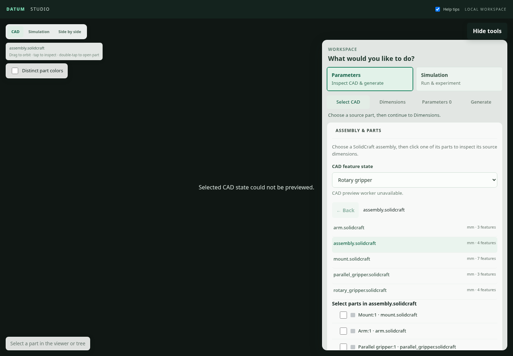

# Datum Studio: parameters and CAD configurations

This guide covers two related Studio workflows: mapping saved CAD dimensions
into named parameters, and selecting native CAD configurations or history
points for a simulation or URDF export. The selected CAD state is currently
used by simulation and URDF export. Parameter generation still reads **Saved
state**; Studio disables generation for an alternate state, and the API rejects
such a request with `CAD_STATE_EXTRACTION_UNSUPPORTED`. It does not silently
generate parameters from another state.

## Start Studio with the example

From the repository root, with Docker Compose, `solidcraft-cli`, and the
`dparam-std` command installed, start the feature-history example:

```sh
dparam-std up --source-repo "$PWD" --project "$PWD/examples/cad_history"
```

Open the local URL printed by the command. Studio runs locally; saved CAD stays
in the project folder. The feature-state selector is scoped to the selected
assembly and displays **Saved state**, history points, and native configuration
rows discovered from that file.

## Map dimensions to parameters

The Parameters workspace tracks the CAD inspection and generated artifact
steps. Start from **Select CAD**, inspect a feature or sketch dimension, then
name parameters and review the generated spec.


*The shipped Studio interface. This capture shows the Parameters workspace before a dimension is mapped.*

1. In the CAD workspace, select the saved assembly, then select a part.
2. Choose a feature or sketch dimension in the **Dimensions** step. The selected
   explicit numeric value is the source for the mapping.
3. In **Parameters**, add a code parameter name and review its
   source file, JSON pointer, units, and converted value in metres.
4. Keep the state selector on **Saved state**. Parameter generation is based on
   the saved document and does not activate a native configuration.
5. Generate and download the spec and artifacts, then use the named values from
   Python or C++ as described in the [package usage guide](AGENT_USAGE.md).

Parameter-spec **worktrees** are named input sets within a parameter spec. They
are independent of a SolidCraft configuration or history point. Selecting a
different worktree does not change CAD geometry.

## Choose a CAD state for simulation or URDF export


*The selected CAD state is explicit and tied to the selected assembly.*

In **CAD feature state**, choose **Parallel gripper**, **Rotary gripper**, **No
gripper**, or **Mount only**. These are native configuration rows in the
example. Entries named **After …** are points on SolidCraft's linear feature
history, not branches. SolidCraft does not expose feature-history branches or
branch tips.

The selected state is captured and activated in a temporary copy for preview,
simulation, and URDF export. The saved CAD source is not modified. If activating
a selection would unsuppress an import missing from the original capture,
Studio rejects it; save that state in SolidCraft first. Inspect generated
geometry and diagnostics, since feature-history points may leave incomplete
geometry or joints.

## Parameters and alternate configurations

Currently, select **Saved state** before generating parameters. If an alternate
state is selected, the UI disables generation and the generation API returns
`CAD_STATE_EXTRACTION_UNSUPPORTED`. This protects against presenting saved-state
dimensions as though they came from the selected configuration. Configuration-
aware parameter extraction is not implemented yet.

To use configuration-specific dimensions today, save that configuration as the
intended source document in SolidCraft, re-open or refresh it in Studio, and
generate parameters from that saved document. Keep a copy of the original CAD
and verify the selected source path and displayed dimension values before
generating. Do not assume a spec worktree selects a CAD configuration.

You can materialize a native configuration without changing the saved assembly,
then map the resulting file in Studio or a spec:

```sh
dparam-std materialize --project "$PWD/examples/cad_history" \
  --assembly assembly.solidcraft --configuration "Parallel gripper" \
  --output "$PWD/examples/cad_history/derived/parallel.solidcraft"
```

Use `--feature-id ID` instead of `--configuration NAME` for a history point.
The project is copied to a temporary capture, the requested state is activated
there, and the activated CAD is written to a new output file. Point parameter
mappings at that output file; normal runtime/generated hash checks then bind to
the materialized state. `solidcraft-cli` is required.

## Verify and use configurations without the browser

List the native configuration rows and history points for an assembly:

```sh
dparam-std configurations --project "$PWD/examples/cad_history" --assembly assembly.solidcraft
```

The Python discovery API is `datum_parameter_studio.configurations.discover`.
This command discovers state names; it does not extract dimensions for those
states. See the [feature-history example](../examples/cad_history/README.md) for
its limits and the [Studio guide](../parameter_studio/README.md#cad-feature-states)
for capture and freshness details.

## Screenshots

The screenshots above are captures of the shipped Studio interface using the
repository's `examples/cad_history` project. The configuration preview worker
was unavailable in the capture environment, so the screenshot shows the
selected configuration control and the corresponding preview-unavailable
message; it does not claim that the preview rendered successfully.
